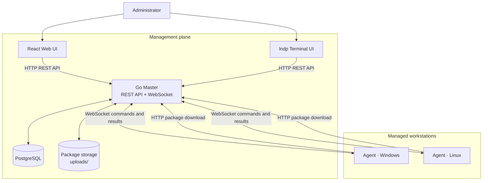

<div align="center">
  
  <h1>LANdapter</h1>
  <p><strong>Centralized workstation deployment and device diagnostics for Windows and Linux networks.</strong></p>
  <p>One Master. A fleet of Agents. A clearer view of your LAN.</p>

  <p>
    <a href="https://github.com/chocom1nt/LANdapter/actions/workflows/ci.yml"></a>
    
    
    
    
    <a href="LICENSE"></a>
    <a href="docs/README.md"></a>
  </p>

  <p>
    <a href="#-quick-start">Quick start</a> ·
    <a href="#-what-it-does">Features</a> ·
    <a href="#-architecture">Architecture</a> ·
    <a href="#-documentation">Documentation</a> ·
    <a href="#-contributing">Contributing</a>
  </p>
</div>

---

**LANdapter** is a self-hosted client–server toolkit for managing software deployment and collecting workstation diagnostics across a local network. A central **Master** coordinates **Agents** installed on Windows or Linux machines. Administrators can work from a React web dashboard or the interactive `lndp` terminal UI.

> **Project status:** under active development. The core deployment and diagnostics workflows are present; production service installation, continuous telemetry, and proactive alerting are not included yet. See [current limitations](#-current-status-and-limitations) before planning a rollout.

## ✨ What it does

<table>
  <tr>
    <td width="50%" valign="top">
      <h3>📦 Software deployment</h3>
      Upload packages centrally and dispatch installers to selected online Agents. Review per-client job results and installation output.
    </td>
    <td width="50%" valign="top">
      <h3>🖥️ Device diagnostics</h3>
      Inspect Windows Plug and Play or Linux PCI/USB inventory, driver versions and providers where available, and device problem hints.
    </td>
  </tr>
  <tr>
    <td width="50%" valign="top">
      <h3>📈 Workstation snapshots</h3>
      Request current CPU, memory and uptime data from online Agents. Keep job history and before/after snapshots for installations.
    </td>
    <td width="50%" valign="top">
      <h3>🧭 Two ways to operate</h3>
      Use the React dashboard for visual administration or `lndp` for a keyboard-driven, two-pane terminal workflow.
    </td>
  </tr>
  <tr>
    <td width="50%" valign="top">
      <h3>⚙️ Policies and schedules</h3>
      Define package policies with an OS substring filter, dispatch them immediately, or repeat installation runs at an interval.
    </td>
    <td width="50%" valign="top">
      <h3>🔐 Separate credentials</h3>
      Protect administrative API calls with an admin token and give each Agent its own credential. Token hashes—not raw Agent tokens—are stored in PostgreSQL.
    </td>
  </tr>
</table>

### Supported installer formats

| Platform | Formats | Notes |
|---|---|---|
| Windows | `.exe`, `.msi`, `.inf` | Silent, basic UI, or interactive mode where supported by the installer; Windows may create a restore point before installation. |
| Linux | `.deb`, `.run`, `.tar`, `.tar.gz`, `.tar.bz2`, `.tgz` | Execution behavior depends on the package and vendor-provided install scripts. |

Driver inventory is **diagnostic**, not an automatic driver-update engine: LANdapter does not currently search vendor catalogs, download drivers, verify signatures, or automatically choose and install replacement drivers.

## 🏗️ Architecture



**How a deployment works:** an administrator uploads a package → selects target Agents → Master creates a job and sends commands to online Agents → Agents download and run the installer → Agents report results → the dashboard and terminal UI show job status.

The Agent reconnects automatically when the Master connection is interrupted. Currently it runs as a foreground process unless you configure an external service manager; the repository does not include a native Windows Service or `systemd` installer.

## 🚀 Quick start

### Requirements

- Docker Engine and the Docker Compose plugin
- Node.js 18+ for the frontend
- Go 1.26.4+ only when building or running Go binaries outside Docker

### 1. Prepare the environment and start Master

From the repository root:

```bash
make quickstart
```

This command creates or repairs `.env`, creates local config files from examples when needed, installs frontend dependencies, and starts PostgreSQL + Master. On a **new empty Docker volume**, PostgreSQL initializes the schema from the migration scripts. Existing databases are not reset or migrated by init scripts.

### 2. Start the web interface

In a separate terminal:

```bash
make run-frontend
```

Open [http://localhost:3000](http://localhost:3000). Then run `make copy-token` and paste the copied admin token into **Settings**. The web UI keeps it for the current browser session; `lndp` reads the token from `.env`.

### 3. Build and run the terminal UI (optional)

```bash
make build-tui
make run-tui
```

### 4. Enroll and start an Agent

In Settings, issue a separate credential for each Agent and save the matching `uuid` and `token` in that workstation's private `configs/agent.yaml`. Then run:

```bash
make run-agent
```

Agents currently need an admin-issued per-agent credential; unrestricted self-registration is intentionally not enabled. Read [Agent lifecycle and unattended deployment](docs/en/AGENT-LIFECYCLE.md) for the current flow and the planned safer bootstrap-enrollment model.

> **Protect your data:** do not run `docker compose down -v` unless you intend to delete the database volume. For existing/manual installations, upgrades, TLS setup, and production hardening, follow the [installation guide](docs/en/INSTALL.md) and [deployment guide](docs/en/DEPLOY.md).

## 🧰 Build and test

### Build Go binaries

```bash
make build
```

Or build individual entry points directly:

```bash
go build -o bin/master ./cmd/master
go build -o bin/agent ./cmd/agent
go build -o bin/lndp ./cmd/lndp
```

### Build the frontend

```bash
cd web
npm ci
npm run build
```

Static assets are written to `web/dist/`.

### Run tests

```bash
make test
make test-cover
```

The GitHub Actions CI workflow runs Go tests, `go vet`, Go builds, frontend tests, and the frontend production build. There is not yet a database-backed integration test suite; the `make test-integration` target is reserved until those tests are added.

### Build Docker images

```bash
docker build -t landapter-master .
docker build -f Dockerfile.agent -t landapter-agent .
```

`docker-compose.yml` starts PostgreSQL and Master only. It does not start the web frontend or register/run Agents.

## 📚 Documentation

Choose a language for the full set of guides. English is the reference version; translated guides document the same current behavior and limitations.

| Language | Project guide | Full documentation index |
|---|---|---|
| 🇬🇧 English | [README](README.md) | [Docs index](docs/README.md) |
| 🇷🇺 Русский | [Обзор проекта](docs/ru/README.md) | [Индекс документации](docs/README.md) |
| 🇯🇵 日本語 | [プロジェクト概要](docs/ja/README.md) | [ドキュメント一覧](docs/README.md) |
| 🇨🇳 简体中文 | [项目概览](docs/zh/README.md) | [文档索引](docs/README.md) |
| 🇪🇸 Español | [Descripción del proyecto](docs/es/README.md) | [Índice de documentación](docs/README.md) |

Useful starting points:

- [Installation](docs/en/INSTALL.md) · [Configuration](docs/en/CONFIG.md) · [Architecture](docs/en/ARCHITECTURE.md)
- [Production deployment](docs/en/DEPLOY.md) · [API reference](docs/en/README.API.md) · [FAQ](docs/en/FAQ.md)
- [Terminal UI guide](docs/en/TUI.md) · [Devices, policies and scheduler](docs/en/DEVICES-POLICIES-SCHEDULES.md)
- [Agent lifecycle and unattended deployment](docs/en/AGENT-LIFECYCLE.md) · [Release checklist](docs/en/RELEASE-CHECKLIST.md)

## 🧭 Current status and limitations

| Area | Current state |
|---|---|
| Agent connectivity | WebSocket connection with automatic reconnect |
| Agent execution | Foreground process; native Windows Service / `systemd` installer not included |
| Device inventory and metrics | Queried on demand, not continuous telemetry |
| Administrator notifications | Proactive alerts/event forwarding are not implemented |
| Policies | OS substring filter; persistent dynamic groups and tags are not implemented |
| Scheduling | Interval-based repeat of package-policy runs; not a general-purpose cron engine |
| Offline jobs | Automatic redelivery of pending install jobs on Agent reconnect is not implemented |
| Driver management | Inventory and diagnostic hints only; no driver catalog search/download/verification/install pipeline |
| Authentication transport | HTTPS/WSS is not enabled by default; use a TLS reverse proxy outside trusted isolated networks |
| Integrations | AD/LDAP and richer group management remain future work |

Before a production rollout, review [security and deployment guidance](docs/en/DEPLOY.md), keep Master and PostgreSQL on trusted network segments, restrict access to administrative credentials, and validate installers on a test workstation.

## 🗂️ Project structure

```text
LANdapter/
├── cmd/
│   ├── master/       # Master server entry point
│   ├── agent/        # Workstation Agent entry point
│   └── lndp/         # Interactive terminal UI
├── internal/
│   ├── common/       # Shared configuration, logging and types
│   ├── master/       # HTTP API, WebSocket server and handlers
│   └── agent/        # Agent connection and installer execution
├── storage/          # Storage layer and PostgreSQL implementation
├── migrations/       # Database schema migrations
├── web/              # React + Vite frontend
├── docs/             # English, Russian, Japanese, Chinese and Spanish docs
├── configs/          # Example Master and Agent configuration
├── scripts/          # Setup, maintenance and development scripts
├── docker-compose.yml
├── makefile
└── go.mod
```

## 🤝 Contributing

Issues, bug reports, documentation improvements, and pull requests are welcome. Please read the [contributing guide](docs/en/CONTRIBUTING.md) and include reproduction steps for bugs.

- [Open an issue](https://github.com/chocom1nt/LANdapter/issues)
- [Browse open pull requests](https://github.com/chocom1nt/LANdapter/pulls)


## 📄 License

LANdapter is released under the [MIT License](LICENSE).

<div align="center">
  <sub>Built for practical administration of real-world LANs.</sub>
</div>
