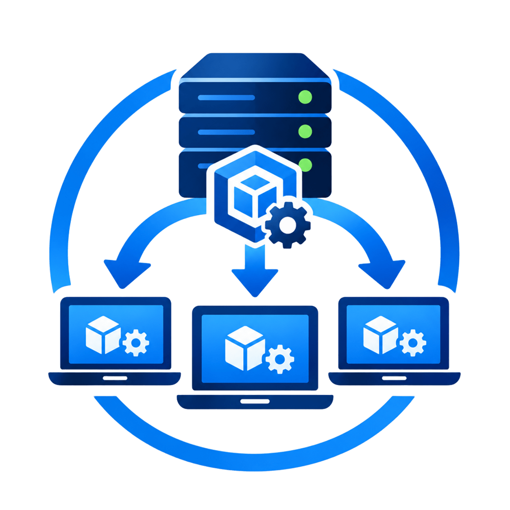

# LANdapter

<p align="center">
  
</p>

<p align="center">
  
  
  
  
</p>

**言語:** [English](../../README.md) · [Русский](../ru/README.md) · [中文](../zh/README.md) · [日本語](README.md) · [Español](../es/README.md)

**LANdapter** は、ローカルネットワーク上でドライバとソフトウェアを集中リモートインストールするクライアント–サーバーシステムです。

**マスター**（サーバー）と **エージェント**（クライアント端末）で構成されます。マスターは接続されたエージェントを管理し、ファイルを配布し、インストールの進捗を追跡します。エージェントは WebSocket でコマンドを受信し、ファイルをダウンロードして、サイレントまたは対話モードでインストールを実行します。

オフィスや産業ネットワークで、数十～数百台の PC にドライバ更新やアプリ配布を迅速に行うワークステーション管理を簡素化することを目的としています。

---

## 機能

- **集中管理** – すべてのエージェントが単一のマスターに接続。
- **リモートインストール** – EXE、MSI、INF、DEB、RUN、TAR などを配布し、適切な引数で実行。
- **2 つのインストールモード** – サイレント（UI なし）と対話（ユーザーインターフェースあり）。
- **統計収集** – CPU、RAM、稼働時間などのメトリクスとデバイス一覧（PnP、lsusb、lspci）。
- **履歴とレポート** – 各ジョブを DB に保存し、インストール前後のシステムスナップショットを保持。
- **復元ポイント** – Windows でインストール前に自動的に復元ポイントを作成。
- **Web UI** – ダークテーマの React ダッシュボード、ファイルライブラリ、インストールウィザード。
- **柔軟な設定** – YAML と環境変数。
- **クロスプラットフォーム** – Master と Agent は Windows / Linux に対応します。macOS でのインストール実行は現在未対応です。

---

## クイックスタート

### 必要条件

- Docker Engine と Docker Compose プラグイン
- Web UI 用の Node.js 18 以降
- Docker の外で Go バイナリをビルド・実行する場合のみ Go 1.26.4 以降

### 準備と起動

リポジトリのルートで実行します。

```bash
make quickstart
```

`make quickstart` は `.env` を作成または修復し、必要なサンプル設定をコピーして、Web UI の依存関係をインストールし、PostgreSQL と Master を起動します。**新しい Docker volume** では PostgreSQL が SQL マイグレーションからスキーマを初期化します。既存 DB では初期化スクリプトは再実行されません。

別々のターミナルで Web UI をインストールして起動します。

```bash
make run-frontend
```

`http://localhost:3000` を開き、`make copy-token` を実行して、クリップボードの管理者トークンを **Settings** に一度だけ貼り付けます。ブラウザは現在のセッション中だけトークンを保持します。`lndp` は `.env` からトークンを自動読込します。

TUI をビルドして起動するには:

```bash
make build-tui
make run-tui
```

Settings で Agent ごとの認証情報を発行し、`configs/agent.yaml` に保存してから `make run-agent` を実行します。

既存のインストールや手動 PostgreSQL 構成については[インストールガイド](INSTALL.md)を参照してください。DB volume を削除する意図がない限り `docker compose down -v` は実行しないでください。

---

## ソースからのビルド

## ソースからのビルド

### Go バイナリ

```bash
make build
```

または:

```bash
go build -o bin/master cmd/master/main.go
go build -o bin/agent cmd/agent/main.go
```

### フロントエンド

```bash
cd web
npm run build
```

静的ファイルは `web/dist/` に出力されます。

### Docker イメージ

```bash
# マスター
docker build -t landapter-master .

# エージェント
docker build -f Dockerfile.agent -t landapter-agent .
```

`make quickstart` で環境を準備し、PostgreSQL と Master を起動できます。新しい volume では PostgreSQL がスキーマを初期化します。Web UI は `make run-frontend` で別途起動します。既存環境については[インストールガイド](INSTALL.md)を参照してください。

---

## プロジェクト構成

```text
LANdapter/
├── cmd/                  # エントリポイント
│   ├── master/
│   └── agent/
├── internal/             # 内部パッケージ
│   ├── common/           # 共通型、ログ、設定
│   ├── master/           # マスター（HTTP、WebSocket、ハンドラ）
│   └── agent/            # エージェント（接続、インストール）
├── storage/              # データ層（インターフェース + PostgreSQL）
├── migrations/           # SQL マイグレーション
├── web/                  # React フロントエンド
├── docs/                 # ドキュメント
├── configs/              # 設定サンプル
├── uploads/              # アップロード（自動作成）
├── docker-compose.yml
├── makefile
├── go.mod
└── README.md
```

---

## ドキュメント

全ドキュメントの索引は [docs/README.md](../README.md) です。目的に応じて次のガイドを参照してください。

- [インストール](INSTALL.md)：要件、DB、マイグレーション、Master/UI 起動、Agent 登録。
- [設定](CONFIG.md)：Master/Agent の設定項目と環境変数。
- [アーキテクチャ](ARCHITECTURE.md)：構成要素、資格情報、WebSocket、現状の制限。
- [本番デプロイ](DEPLOY.md)：TLS proxy、サービス保護、バックアップ、更新。
- [API](README.API.md)：REST エンドポイントと WebSocket プロトコル。
- [FAQ](FAQ.md) と [コントリビューション](CONTRIBUTING.md)。

---

## 関連ドキュメント

- [Agent のライフサイクルと無人展開](AGENT-LIFECYCLE.md) — 登録、サービス運用、自動登録の安全な設計。
- [TUI](TUI.md) — クライアント、デバイス、監視、パッケージ管理。
- [デバイス一覧、ポリシー、スケジューラー](DEVICES-POLICIES-SCHEDULES.md) — 現在の機能と制限。

## テスト

ユニットテスト:

```bash
make test
```

統合テスト（実 DB が必要）:

```bash
make test-integration
```

カバレッジ:

```bash
make test-cover
```

---

## 現在の制限とロードマップ

- ポリシーは OS の部分文字列フィルターを使用します。永続的なクライアントグループやタグは未実装です。
- ダッシュボードのメトリクスは現在値であり、履歴時系列は保存されません。
- ドライバーの自動検索・署名検証・インストールは未実装です。
- Windows サービス/systemd のネイティブ導入と自動登録フローは今後の作業です。
- Master CLI（Web UI なし運用）は今後の候補です。
- Active Directory / LDAP 連携
- 追加パッケージ形式（AppImage、Flatpak）
- スケジュールジョブ
- ベンダーサイトからのドライバ解析の改善

---

## ライセンス

MIT ライセンス。詳細は [LICENSE](../../LICENSE) を参照してください。

---

質問や提案は [Issue](https://github.com/chocom1nt/LANdapter/issues) または Pull Request でお知らせください。
